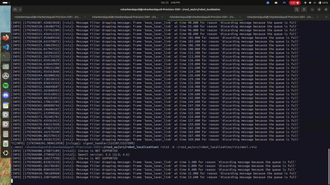
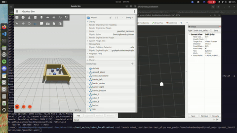
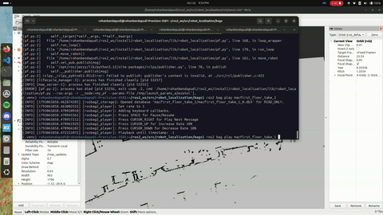

# State Estimation and Localization Project

## Project Overview

For our state estimation and localization project, we designed a particle filter that uses the closest obstacle method to localize our Neato robot. Furthermore, our project leverages a Gaussian Kernel Density Estimation (KDE) to resample our particles. In broad strokes, our particle filter initializes a particle cloud of N particles, and as our Neato moves across the map, the particle filter calculates the change in odometry movement for each particle. Then, for each particle, our algorithm calculates the distance to the closest obstacle and compares against the LIDAR scan – assigning normalized weights based on these comparisons. Finally, we use our Gaussian KDE-based resampling approach to generate a set of new N particles.

## Approach to State Estimation

### Algorithm Overview

For our state estimation algorithm, we initialized a particle cloud of random N particles by using a normal distribution to generate x, y, and theta values, based on fixed noise values for the x-y and theta planes. Once the Neato detects movement (which is thresholded at X meters) in the odometry frame, our algorithm will calculate the change in Neato movement in the odometry frame and apply that movement change to every particle. 

#### INCLUDE ODOMETRY CALCULATION

After applying that movement change to every particle, our algorithm will compare the distance of the closest object to each particle against the distance of the closest object from the Neato’s LIDAR scan. 

#### INCLUDE THE WEIGHT CALCULATION

Once we calculate the weight of each particle, we estimate the most likely position for the Neato by finding the particle with the highest weight. 

After completing state estimation of the Neato, we resample our particles by selecting 50 particles with the highest weights. Then, we apply Gaussian Kernel Density Estimation (KDE) on these resampled particles to generalize a probability distribution of these highest weights. Finally, we generate a new set of N particles using the Gaussian KDE probability distribution.

### Implementation Design

#### Design Decision 1: Particle Resampling
One key design decision that we made was to use a Gaussian KDE to generate a new set of N particles. Initially, we used the calculated weights as a probability distribution to generate a new set of N particles. While this solution partially worked, we saw that the resampled particle cloud became too noisy–which caused the Neato to inaccurately estimate its position. 

To reduce noise, we then decided to generalize the distribution of particle weights into a Gaussian distribution, utilizing the mean and standard deviation of the particle weights. However, dynamically controlling the shape of the Gaussian distribution through standard deviation became a non-trivial problem. When we used the actual standard deviation of the weights, the resampling method created too much noise, but when we constrained the standard deviation to a smaller value, we found that the Neato would estimate the wrong pose and move in the wrong direction. We also tried to use a Gamma distribution – but equally, we came across issues tuning the alpha and beta parameters. 

We then contemplated a probability distribution that could accurately represent multimodality in a distribution and didn’t rely on parametric tuning. Upon deeper research, we found the Gaussian Kernel Estimation algorithm, which could dynamically represent the shape of a distribution. We also realized that we could manually resample data from the calculated particle weights. So, we introduced a preprocessing step that would sort the particles by weight and randomly choose from the 50 best weights. After this preprocessing step, we applied a Gaussian KDE function to create a probability distribution and then generate 400 new particles from the distribution. Immediately after testing this algorithm, we found that this new implementation allowed our particle filter to represent Neato position in high fidelity. 

### Weights Calculation (Pending)

## Unit Test Design and Integration

## Experimental Design

To iterate on our particle filter, we first tested our algorithm in simulation using Gazebo and rviz2. Using Gazebo, we would set up the Gauntlet environment in simulation, and then, we launch acml.rviz with rviz2 to visualize the particle filter in real-time. We mainly evaluated our particle filter by comparing the position of our Neato robot in rviz2 against the simulated position in Gazebo. In addition, we’d also evaluate the efficacy of our particle resampling strategy by analyzing the spread of particles in each iteration of the particle filter. This setup with the Gauntlet world served as a gateway experiment to quickly evaluate whether our algorithm succeeded or failed.

For example, when we initially tested our normal distribution algorithm, we quickly discovered that there were several logical flaws – which resulted in completely innaccurate slocalization:

However, once we successfully validated an algorithm (as seen below), we moved onto the next step, which was to test on a map from the MAC (specifically `maps/mac_1st_floor_final.yaml`).  

Instead of using Gazebo simulation, we used the recorded bagfiles and launched rviz2 to see where the Neato evaluated its position in the MAC. Below, we’ve included our current particle filter example using `macfirst_floor_take_1` bagfile.

# Challenges and Next Steps

# Learning Objectives and Final Takeaways

# How To Run
