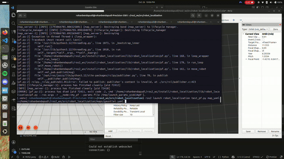

# State Estimation and Localization Project

## Project Overview

For our state estimation and localization project, we designed a particle filter that uses the closest obstacle method to localize our Neato robot. Furthermore, our project leverages a Gaussian Kernel Density Estimation (KDE) to resample our particles. In broad strokes, our particle filter initializes a particle cloud of N particles, and as our Neato moves across the map, the particle filter calculates the change in odometry movement for each particle. Then, for each particle, our algorithm calculates the distance to the closest obstacle and compares against the LIDAR scan – assigning normalized weights based on these comparisons. Finally, we use our Gaussian KDE-based resampling approach to generate a set of new N particles.

## Approach to State Estimation

### Algorithm Overview

For our state estimation algorithm, we initialized a particle cloud of random N particles by using a normal distribution to generate x, y, and theta values, based on fixed noise values for the x-y and theta planes. Once the Neato detects movement (which is thresholded at X meters) in the odometry frame, our algorithm will calculate the change in Neato movement in the odometry frame and apply that movement change to every particle. 

#### Odometry Calculation

First, we calculate the change in the Neato's position and orientation between two odometry measurements:

`Δx = x_new − x_old`
`Δy = y_new − y_old`
`Δθ = θ_new − θ_old`

Next, we convert this into forward and sideways movement relative to its previous orientation:

`forward = Δx × cos(θ_old) + Δy × sin(θ_old)`
`sideways = −Δx × sin(θ_old) + Δy × cos(θ_old)`

Finally, we can update each particle's position using its own orientation:

`x_new = x_old + forward × cos(θ_p) − sideways × sin(θ_p) + noise_x`
`y_new = y_old + forward × sin(θ_p) + sideways × cos(θ_p) + noise_y`
`θ_new = θ_p + Δθ + noise_θ`

θ_p represents the particle's orientation, and the noise terms represent Gaussian noise added to account for uncertainty in movement. We also normalize the resulting orientation to handle angle wraparound issues. We use 0.03 meters of positional noise and 0.02 radians of rotational noise.

After applying that movement change to every particle, our algorithm will compare the distance of the closest object to each particle against the distance of the closest object from the Neato’s LIDAR scan. 

#### Weight Calculation

After updating the particle positions, we use LiDAR measurements to calculate how well each particle matches the map.

First we calculate the LiDAR endpoint where, for each particle, we calculate the location of an obstacle based on the LiDAR distance and angle. 

`x_end = x_p + r × cos(θ_p + α)`
`y_end = y_p + r × sin(θ_p + α)`

In this case x_p and y_p are Particle position, θ_p is Particle orientation, r is LiDAR distance measurement, and α is LiDAR measurement angle

Next, we calculate the distance (d) between the predicted LiDAR endpoint and the closest obstacle in the map.
`score = exp(−d² / (2 × σ²))`

Where d is the distance to the closest obstacle and σ = 0.25 meters (measurement uncertainty). A smaller distance results in a score closer to 1, while a larger distance results in a score closer to 0.

Next we calculate particle weight by adding the scores from the selected LiDAR measurements:
`particle_weight = score₁ + score₂ + score₃ + ... + scoreₙ`

Finally, we normalize each particle's weight, ensuring they all add up to 1. 

`normalized_weight = particle_weight / sum_of_all_particle_weights`

We give the particles whose predicted LiDAR measurements better match the map higher weights to make them more likely to be selected during resampling.

Once we calculate the weight of each particle, we estimate the most likely position for the Neato by finding the particle with the highest weight. 

After completing state estimation of the Neato, we resample our particles by selecting 50 particles with the highest weights. Then, we apply Gaussian Kernel Density Estimation (KDE) on these resampled particles to generalize a probability distribution of these highest weights. Finally, we generate a new set of N particles using the Gaussian KDE probability distribution.

### Implementation Design

#### Design Decision 1: Particle Resampling
One key design decision that we made was to use a Gaussian KDE to generate a new set of N particles. Initially, we used the calculated weights as a probability distribution to generate a new set of N particles. While this solution partially worked, we saw that the resampled particle cloud became too noisy–which caused the Neato to inaccurately estimate its position. 

To reduce noise, we then decided to generalize the distribution of particle weights into a Gaussian distribution, utilizing the mean and standard deviation of the particle weights. However, dynamically controlling the shape of the Gaussian distribution through standard deviation became a non-trivial problem. When we used the actual standard deviation of the weights, the resampling method created too much noise, but when we constrained the standard deviation to a smaller value, we found that the Neato would estimate the wrong pose and move in the wrong direction. We also tried to use a Gamma distribution – but equally, we came across issues tuning the alpha and beta parameters. 

We then contemplated a probability distribution that could accurately represent multimodality in a distribution and didn’t rely on parametric tuning. Upon deeper research, we found the Gaussian Kernel Estimation algorithm, which could dynamically represent the shape of a distribution. We also realized that we could manually resample data from the calculated particle weights. So, we introduced a preprocessing step that would sort the particles by weight and randomly choose from the 50 best weights. After this preprocessing step, we applied a Gaussian KDE function to create a probability distribution and then generate 400 new particles from the distribution. Immediately after testing this algorithm, we found that this new implementation allowed our particle filter to represent Neato position in high fidelity. 

### Weights Calculation (Pending)

## Unit Test Design and Integration
To test our particle filter, we created 7 unit tests with pytest. To make them easy to run without having to launch the whole ROS2 environment, we created a particle filter object and used a fake transform to simulate coordinate transformations.
We also disabled movement noise during the odometry tests so that we could compare particle positions against exact expected values.

The 7 tests we implemented are: 
- Particle Initialization: Verified that the 400 particles we generate are generated and are close to the position we specified
- Weight Normalization: Verified that particle weights are normalized correctly and add up to 1
- Odometry Movement: Tested whether particles move in the correct direction based on their orientation
- LiDAR Weight Calculation: Verified that particles whose LiDAR measurements better match the wall (in simulation) receive higher weights
- Zero-Weight Handling: Tested if the normalization function distributes equal weights when all weights are zero.
- Rotation: Verified that a 90-degree rotation updates a particle's orientation, but not position 
- Resampling: Verified that resampling generates 400 particles and favors the particle with the highest weight (all resampled particles should come from first particle with a weight of 1, all others have a weight of 0) 
These tests were very helpful in testing if the math was correct and actually helped us realize our initial KDE resampling implementation was incorrect since it failed the resampling unit test. Combining these tests with simulation and bagfile testing allowed us to properly implement our particle filter

## Experimental Design

To iterate on our particle filter, we first tested our algorithm in simulation using Gazebo and rviz2. Using Gazebo, we would set up the Gauntlet environment in simulation, and then, we launch acml.rviz with rviz2 to visualize the particle filter in real-time. We mainly evaluated our particle filter by comparing the position of our Neato robot in rviz2 against the simulated position in Gazebo. In addition, we’d also evaluate the efficacy of our particle resampling strategy by analyzing the spread of particles in each iteration of the particle filter. This setup with the Gauntlet world served as a gateway experiment to quickly evaluate whether our algorithm succeeded or failed.

For example, when we initially tested our normal distribution algorithm, we quickly discovered that there were several logical flaws – which resulted in completely innaccurate slocalization:


However, once we successfully validated an algorithm (as seen below), we moved onto the next step, which was to test on a map from the MAC (specifically `maps/mac_1st_floor_final.yaml`).  



Instead of using Gazebo simulation, we used the recorded bagfiles and launched rviz2 to see where the Neato evaluated its position in the MAC. Below, we’ve included our current particle filter example using `macfirst_floor_take_1` bagfile.


You can find the rosbag of our tested particle filter in `bags/test_pf/`

# Challenges and Next Steps

One challenge that we faced was our approach to resampling particles. While our current solution for resampling particles closely resembles our initial solution, we iterated through many different ideas. We first investigated unimodal probability distributions, such as Gamma and Gaussian distributions, to represent the distribution of x, y, and theta values across the particle cloud. For both solutions, we calculated the weighted average and standard deviations for x, y, and theta values across the particle clouds. Then, we tested the `random.normal()` and `random.gamma()` using these weighted average and standard deviation values. (Note, we had to calculate shape and scale for the Gamma distribution and then plug those values into `random.gamma()`.)  However, we discovered that this could not represent the potential multimodality of x, y, and theta values using Gamma and Gaussian distributions. 

We then contemplated a probability distribution that could accurately represent multimodality in a distribution and didn’t rely on parametric tuning. Upon deeper research, we found the Gaussian Kernel Estimation algorithm, which could represent the multimodal shape of a distribution. For example, after sorting particles by weight, the distribution of x, y, and theta values could be multimodal, featuring multiple peaks and better representing potential state estimations. We also realized that we could manually resample data from the calculated particle weights. So, we introduced a preprocessing step that would sort the particles by weight and randomly choose from the 50 best weights. After this preprocessing step, we applied a Gaussian KDE function to create a probability distribution of x, y, and theta values based on the particle weight and then generate 400 new particles from the distribution. While this solution appeared to work in simulation, we discovered with our unit tests and then further digging that our solution had a few logical flaws. 

Firstly, our preprocessing step to sort all the particles by weight removed the need to represent multimodality in a probability distribution. Secondly, and more importantly, we generated new particles using the Gaussian KDE function by dimension (ie. x, y, and theta) using weights – and not the dimensions themselves. Therefore, our solution could randomly pair three dimensions into one pose that may not have a relation to each other. As a result our initial particle filter generated the entire particle itself by using the weights as a probability distribution; the Gaussian KDE-based solution incorrectly generated a pose by dimension. This led us to revert to our initial solution, where we used the weights to directly generate all dimensions of a new particle. 

One potential next step is to improve the Bayesian based Estimation approach in our particle filter. This would require us to more accurately calculate the probability of uncertain information and recursively reduce the uncertainty in our state estimation. In our case, this would mean improving how we calculate the probability of each particle representing the Neato’s actual position, the main challenge being finding appropriate probability distributions. 

Another potential direction for this project is to substitute the closet obstacle method in our particle filter with the ray tracing method. This solution would require us to simulate LIDAR data based on each particle’s position using ray tracing and compare the simulated LIDAR data against the real-time LIDAR data. With the ray tracing method, we would have two key challenges: 1) determining the error between the simulated LIDAR and real-time LIDAR data, and 2) minimizing the computational cost of simulating LIDAR data for all N particles. 

# Learning Objectives and Final Takeaways

In conclusion, this project taught us about how odometry and LiDAR can be used to help localize a robot. 

Some challenges we faced along the way were understanding coordinate frames and applying odometry changes to the particles in the map frame. We also learned how important it is to account for uncertainty with Gaussian Noise. Experimenting with Gaussian, Gamma, and KDE resampling also helped us understand how different particle distributions affect localization before just settling on using standard weighted sampling. 

Finally, as we learned from the previous project, we continue to recognize the importance of testing individual steps before testing the entire system. This time, Unit Tests, Gazebo, and the bagfiles helped us better understand the issues we were running into and speed up the debug process. 

# How To Run
Download our repo
```
cd ~/ros2_ws/src
git clone git@github.com:darianjimenez/particle-filter.git
```
Build our repo
```
cd ~/ros2_ws
colcon build --symlink-install
source install/setup.bash
```

From here, you can play our recorded bagfile.
Open rviz with amcl rviz file
```
rviz2 -d ~/ros2_ws/src/robot_localization/rviz/amcl.rviz 
```
Open another terminal and play the bag file
```
ros2 bag play bags/test_pf
```

Or, you can also test the simulation in real time with rviz
Open rviz again
```
rviz2 -d ~/ros2_ws/src/robot_localization/rviz/amcl.rviz 
```
Run the particle filter
```
ros2 launch robot_localization test_pf.py map_yaml:=/home/rohanbendapudi/ros2_ws/src/robot_localization/maps/mac_1st_floor_final.yaml
```

Play another recorded bagfile
```
ros2 bag play macfirst_floor_take_1
```

Finally, you can also cross-reference our particle simulator against Gazebo:
Launch the Gazebo simulation
```
ros2 launch neato2_gazebo neato_gauntlet_world.py
```
Open rviz again
```
rviz2 -d ~/ros2_ws/src/robot_localization/rviz/amcl.rviz
```
Uncomment this line (move_robot()) and run the particle filter
```
ros2 launch robot_localization test_pf.py map_yaml:=~/ros2_ws/src/robot_localization/maps/gauntlet.yaml
```
(Note: replace ~ with /home/{username})

