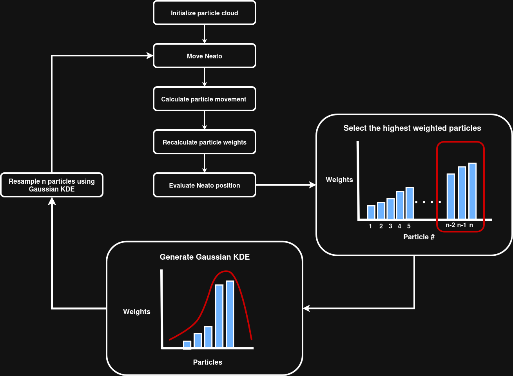

# State Estimation and Localization Project

## Project Overview

For our state estimation and localization project, we designed a particle filter that uses the closest obstacle method to localize our Neato robot. Furthermore, our project leverages a Gaussian Kernel Density Estimation (KDE) to resample our particles. In broad strokes, our particle filter initializes a particle cloud of N particles, and as our Neato moves across the map, the particle filter calculates the change in odometry movement for each particle. Then, for each particle, our algorithm calculates the distance to the closest obstacle and compares against the LIDAR scan – assigning normalized weights based on these comparisons. Finally, we use our Gaussian KDE-based resampling approach to generate a set of new N particles.

## Approach to State Estimation

## Algorithm Overview
